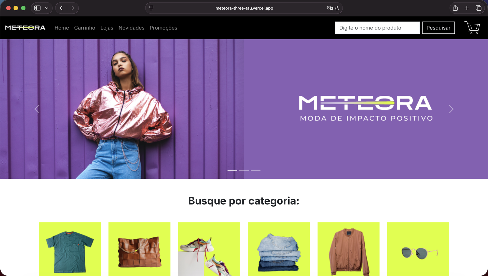
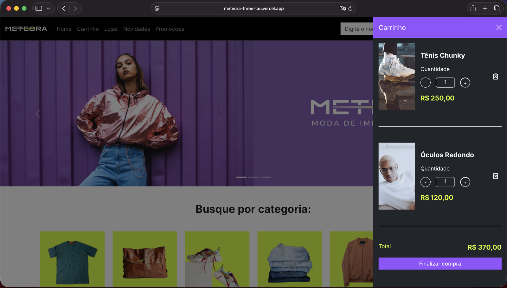

# Meteora

Front-end of a clothing store, built with React. You can browse products, add them to a cart, and change quantities from a side panel or from a full cart page.

**Live demo:** [meteora-three-tau.vercel.app](https://meteora-three-tau.vercel.app)

| Home | Cart panel |
|---|---|
|  |  |

## What's inside

Product data comes from static JSON files, so there is no backend. The work is in the front end:

- **Cart state.** One Context provider holds the cart, and a reducer handles three actions: add a product, remove it, update its quantity. Components go through a `useCarrinhoContext` hook instead of dispatching actions themselves, which is why the item count in the navbar, the side panel and the order summary always match.
- **Two views of the same cart.** A Bootstrap offcanvas panel opens from the navbar, and `/carrinho` shows the full cart with a summary. React Router also serves a 404 page for unknown routes.
- **Layout.** Bootstrap 5 (loaded from a CDN) covers the grid, navbar, carousel and offcanvas. The rest is custom CSS. Prices are formatted with `Intl.NumberFormat` in pt-BR and BRL.

The interface is in Portuguese.

## Stack

React 18, Vite 4, React Router 6, Bootstrap 5.3, deployed on Vercel.

## Run it locally

Requires Node.js 18 or newer.

```bash
git clone https://github.com/victorhubarb/meteora.git
cd meteora
npm install
npm run dev
```

Vite prints the local address, `http://localhost:5173` by default.

## Project structure

```
src/
├── pages/        Home, Carrinho, PaginaErro (404)
├── components/   About 30 components, one folder each
├── context/      CarrinhoContext, the cart provider
├── reducers/     carrinhoReducer: add, remove, update quantity
├── hooks/        useCarrinhoContext
├── utils/        Currency formatter
└── mocks/        Products, categories, perks and carousel data
```

## Known gaps

- The cart resets on reload, because nothing is persisted.
- "Finalizar compra", the search field and the newsletter button are not wired up yet.
- Products are mock data in `src/mocks`.

---

Victor Hugo Barbosa · [GitHub](https://github.com/victorhubarb) · [LinkedIn](https://www.linkedin.com/in/victorhbarbosa/)
